# Mailfluss – redmine_expert_helpdesk

> 🇩🇪 Deutsche Version · [English version](EMAIL_FLOW.md)

Wie eine Mail durch den Helpdesk läuft: vom Postfach ins Ticket und vom Ticket zurück zum Kunden.
Jedes Diagramm nennt die Einstellungen, die seinen Weg verändern, und die
[Einstellungsübersicht](#8-einstellungsübersicht) am Ende listet alle mit dem Ort, an dem sie
gepflegt werden.

**So liest man die Diagramme**: Rechtecke sind Schritte, Rauten Entscheidungen, und der Zusatz an
einem Schritt nennt die Einstellung, die ihn steuert (*kursiv*). Die Farben zeigen, wo eine Mail
landet:

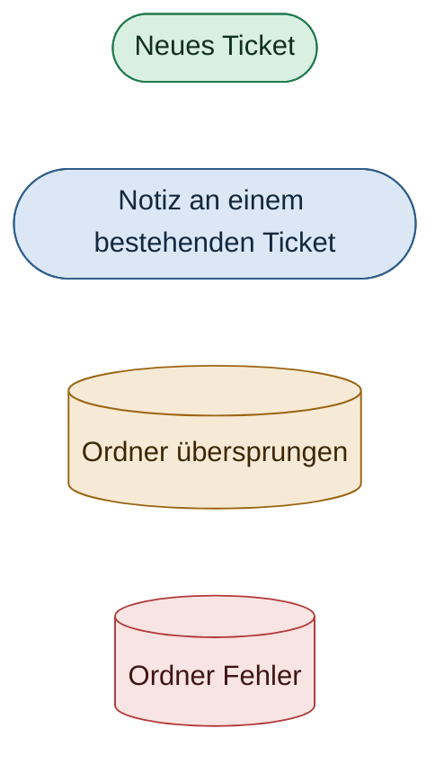

## Inhalt

1. [Das Gesamtbild](#1-das-gesamtbild)
2. [Abruf](#2-abruf)
3. [Filter: Wird die Mail überhaupt verarbeitet?](#3-filter-wird-die-mail-überhaupt-verarbeitet)
4. [Antwort oder neues Ticket?](#4-antwort-oder-neues-ticket)
5. [Was mit dem Ticket passiert](#5-was-mit-dem-ticket-passiert)
6. [Eine Mail, mehrere Projekte](#6-eine-mail-mehrere-projekte)
7. [Ausgehende Mails](#7-ausgehende-mails)
8. [Einstellungsübersicht](#8-einstellungsübersicht)

---

## 1. Das Gesamtbild

Ein Postfach gehört zu genau einem Projekt. Der Abruf liest seinen Quellordner, jede Nachricht
durchläuft dieselbe Pipeline und wird danach in einen von drei Ordnern verschoben. In Redmine
geschriebene Antworten verlassen den Helpdesk über den Versandweg des Postfachs, und die Antwort
des Kunden kommt wieder im Quellordner an.

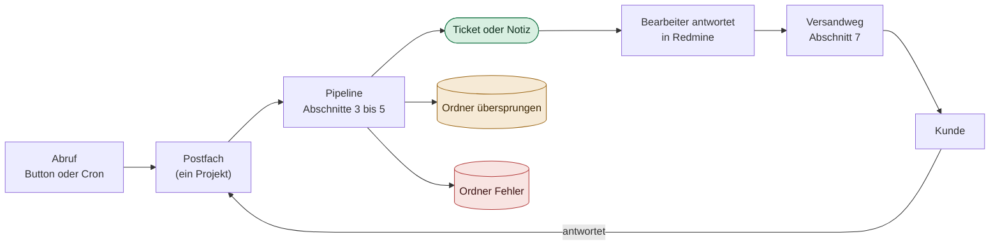

---

## 2. Abruf

Das Plugin hat keinen eigenen Zeitplaner. Ein Abruf startet über den Button in den
Projekteinstellungen oder über den Cron-Endpunkt `GET /helpdesk/fetch_all?key=…`, der zusätzlich
die SLA-Prüfung und den Abgleich der Phishing-Feeds anstößt.

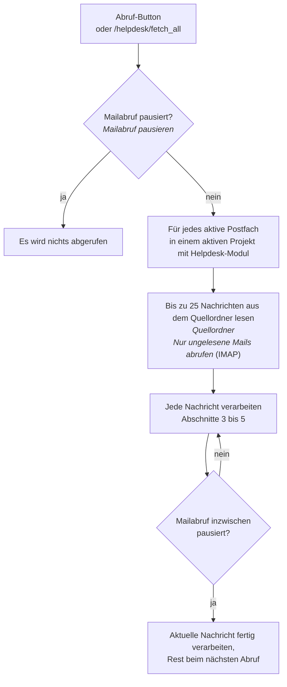

- **IMAP** liest alle Nachrichten des Quellordners, oder nur ungelesene, wenn *Nur ungelesene Mails
  abrufen* gesetzt ist. Microsoft Graph liest immer nur ungelesene Nachrichten.
- Eine verarbeitete Mail wird als gelesen markiert und verschoben, sie wird also nie zweimal
  abgeholt.

---

## 3. Filter: Wird die Mail überhaupt verarbeitet?

Bevor ein Ticket angefasst wird, können fünf Prüfungen eine Mail direkt in den Ordner für
übersprungene Mails schicken. Sie laufen in dieser Reihenfolge, die günstigste zuerst.

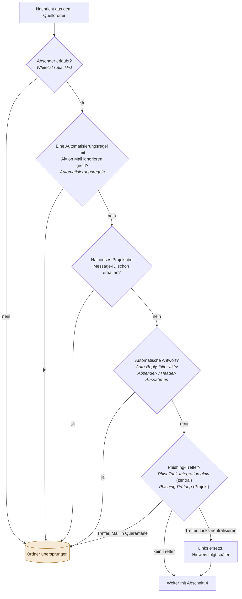

- **Whitelist / Blacklist**: eine Adresse oder Domain pro Zeile. Eine gepflegte Whitelist lässt
  *nur* ihre Absender zu; die Blacklist entfernt danach Absender aus dem Rest.
- **Schon erhalten**: Dieselbe Mail an zwei Postfächer eines Projekts (An und CC) wird einmal
  verarbeitet. Ein anderes Projekt, das sie erhält, ist kein Duplikat, siehe
  [Abschnitt 6](#6-eine-mail-mehrere-projekte).
- **Auto-Reply-Filter**: Abwesenheitsnotizen und ähnliche Mails werden an ihren Headern erkannt.
  Unzustellbarkeitsberichte (NDRs) werden nie gefiltert, denn eine fehlgeschlagene Zustellung muss
  ein Bearbeiter sehen.
- **Ordner übersprungen** fällt auf den Ordner für verarbeitete Mails zurück, wenn er leer ist. Sind
  beide leer, bleibt die Mail im Quellordner und wird nur als gelesen markiert.

---

## 4. Antwort oder neues Ticket?

Das Plugin übergibt die Mail an Redmines eigenen `MailHandler`, der die endgültige Entscheidung
trifft. Vorher passt das Plugin die *Thread-Marker* der Mail an, also die Teile einer Mail, die
sagen, zu welchem Ticket sie gehört:

| Marker | Wo | Beispiel |
| --- | --- | --- |
| Ticket-Tag | Betreff | `AW: [#123] Drucker defekt`, `[Projekt - Fehler #123]` |
| Redmine-Benachrichtigungs-ID | `In-Reply-To` / `References` | `<redmine.issue-123.20261014…@example.com>` |
| Protokollierte Helpdesk-Message-ID | `In-Reply-To` / `References` | ID einer Kundenmail oder Bearbeiterantwort, die der Helpdesk gespeichert hat |
| Forum-Antwort-Tag | Betreff | `AW: [Forum - msg45] …` – wird immer entfernt, ein Helpdesk-Postfach schreibt nie in ein Forum |

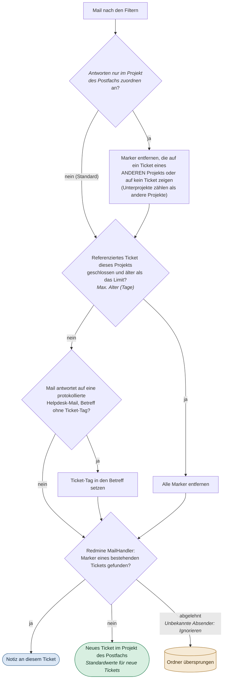

- **Nur das eigene Projekt des Postfachs** (experimentell, standardmäßig aus). Ohne diesen Schritt
  folgt der `MailHandler` einem Marker in jedes Projekt, und jeder, der eine Ticketnummer kennt, kann
  in dieses Ticket schreiben – so verhält es sich, solange der Schalter aus ist. Marker des eigenen
  Projekts bleiben erhalten, die normale Antwort des Kunden findet ihr Ticket also weiterhin. Ein
  Ticket, das über dieses Postfach eröffnet und später in ein anderes Projekt verschoben wurde, zählt
  ebenfalls als eigenes Projekt. Ein Betreff mit mehr als 20 Ticketnummern, mehr als fünf Ebenen
  Verschachtelung oder mehr als 998 Zeichen verliert alle Tags und Klammern,
  `In-Reply-To`/`References` mit mehr als 50 Message-IDs werden verworfen. Die
  am Ticket angehängte `.eml` behält Betreff und Header genau so, wie
  sie angekommen sind.
- **Max. Alter (Tage)** erzwingt ein neues Ticket für eine Antwort auf ein seit Langem
  geschlossenes Ticket. `0` oder leer schaltet das Limit ab.
- **Unbekannte Absender** bestimmt, was der `MailHandler` mit einer Adresse ohne Redmine-Konto macht:
  *Akzeptieren (anonym)*, *Benutzerkonto anlegen* oder *Ignorieren* (die Mail wird übersprungen).
- Der `MailHandler` lehnt außerdem Mails von Redmines eigenem *E-Mail-Absender* ab und wendet
  Redmines Einstellungen unter *Eingehende E-Mails* an (*Schneide E-Mails nach einer dieser Zeilen
  ab*, *Anhänge nach Namen ausschließen*).

---

## 5. Was mit dem Ticket passiert

Nachdem der `MailHandler` das Ticket oder die Notiz angelegt hat, erledigt das Plugin den Rest. Die
beiden Zweige unterscheiden sich nur am Anfang.

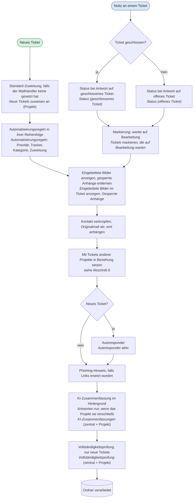

- **Status bei einer Antwort**: Bleibt einer der beiden Status leer, bleibt der Status des Tickets
  unverändert. Ein geschlossenes Ticket, das in einem offenen Status landet, gilt als
  *wiedereröffnet*.
- **Wartet auf Bearbeitung** wird nicht gesetzt, wenn die Mail von einem Bearbeiter stammt.
- Die **KI-Zusammenfassung** läuft für neue Tickets und für Antworten nur, wenn der Umfang im Projekt
  sie einschließt. Die **Vollständigkeitsprüfung** läuft nur für neue Tickets. Beide laufen im
  Hintergrund und halten den Abruf nie auf.
- **Jeder Fehler** in dieser Pipeline verschiebt die Mail in den **Ordner für Fehler**, und der Abruf
  macht mit der nächsten Nachricht weiter. Der Fehler wird am Postfach angezeigt (*letzter Fehler*).

---

## 6. Eine Mail, mehrere Projekte

Kunden schreiben oft an mehrere Helpdesk-Adressen gleichzeitig (An, CC oder BCC), und Kollegen in
einem Projekt wissen nicht unbedingt, dass ein anderes Projekt beteiligt ist. Mit *Antworten nur
im Projekt des Postfachs zuordnen* behandelt jedes Postfach seine Kopie nur für sein eigenes
Projekt. Alles in diesem Abschnitt gilt nur dann; solange der Schalter aus ist, folgt jede Kopie
ihren Markern in das referenzierte Ticket, wie bisher.

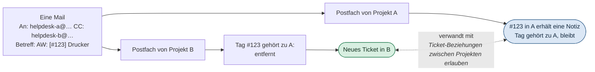

| Situation | Ergebnis |
| --- | --- |
| Kunde schreibt an A und B | Ein Ticket in A, eines in B, miteinander verknüpft |
| Mail an B mit `[#123]` aus Projekt A | Neues Ticket in B, Beziehung zu #123 |
| Antwort auf eine A-Konversation, an B gesendet | Neues Ticket in B, Beziehung zum A-Ticket |
| Bearbeiter aus A antwortet mit der Adresse von B in CC | Neues Ticket in B; nichts kommt zurück nach A |
| Fremder nennt ein Ticket eines Projekts ohne Helpdesk | Neues Ticket, keine Beziehung |
| Dieselbe Mail erreicht zwei Postfächer eines Projekts | Ein Ticket; die zweite Kopie wird übersprungen |

**Wie die Projekte voneinander erfahren**

- **Beziehung *verwandt mit***: wird ohne Historieneintrag und ohne Benachrichtigung angelegt.
  Redmine zeigt sie nur Benutzern, die beide Tickets sehen dürfen. Ein entfernter Ticket-Tag führt
  nur dann zu einer Beziehung, wenn das Projekt dieses Tickets das Helpdesk-Modul hat, denn eine
  Ticketnummer kann jeder in einen Betreff schreiben. Setzt Redmines *Ticket-Beziehungen zwischen
  Projekten erlauben* voraus; ohne die Einstellung werden die Tickets angelegt, aber nicht verknüpft.
- **Seitenleiste *Auch zugestellt an***: die anderen Helpdesk-Adressen aus An und CC. Der
  Projektname erscheint nur für Betrachter, die das Projekt sehen dürfen. Per BCC erreichte
  Postfächer bleiben unsichtbar.

---

## 7. Ausgehende Mails

Vier Arten von Mails verlassen den Helpdesk, und alle nehmen den Versandweg des Postfachs:

| Mail | Ausgelöst durch |
| --- | --- |
| Bearbeiterantwort | *Antworten* auf der Ticketseite |
| Initialmail | Zuordnen eines Kontakts zu einem Ticket, oder *Neues Helpdesk-Ticket* |
| Autoresponder | Ein neues Ticket, wenn *Autoresponder aktiv* |
| Rückfrage der Vollständigkeitsprüfung | Die Vollständigkeitsprüfung findet die Erstmail unvollständig |

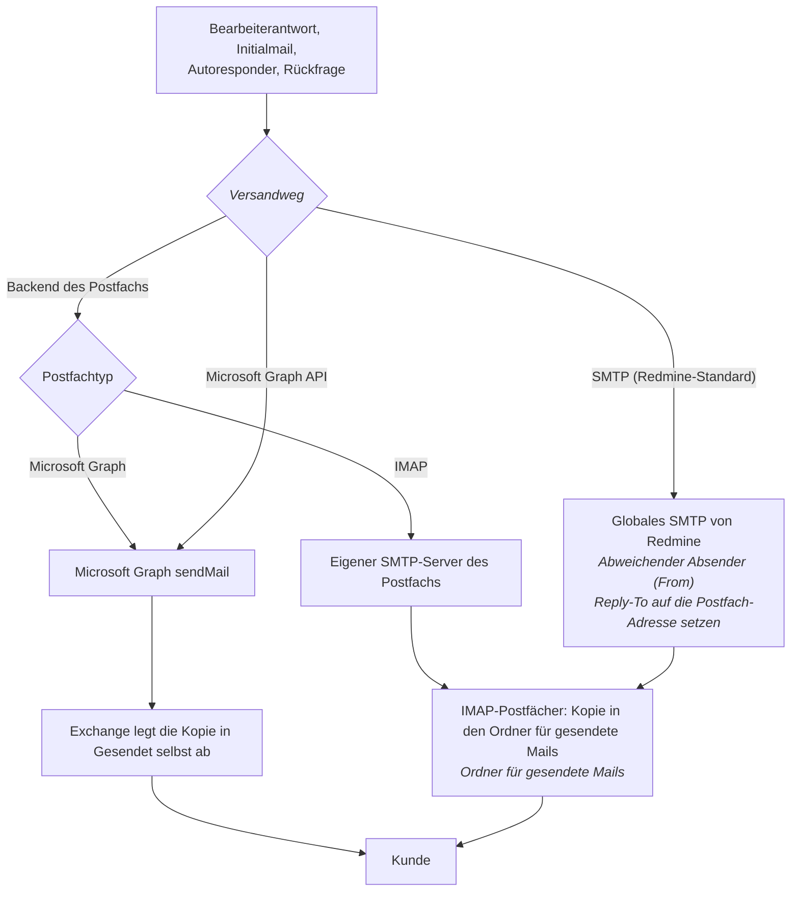

- ***Versandweg* Microsoft Graph API** wird nur angeboten für ein Graph-Postfach oder ein
  IMAP-Postfach bei Microsoft 365, wenn die zentrale App-Registrierung eingerichtet ist.
- **SMTP (Redmine-Standard)** bettet Inline-Bilder als Data-URIs ein. Die beiden anderen Wege
  schicken sie als Anhänge, auf die das HTML verweist.

**Wie die Antwort des Kunden ihr Ticket wiederfindet**

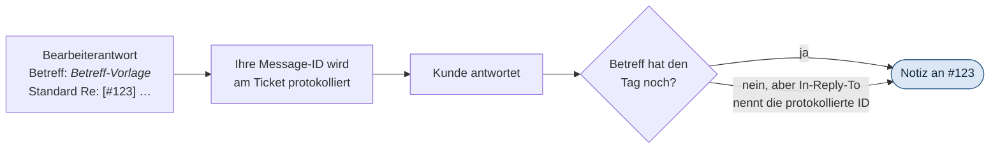

- Die **Betreff-Vorlage** der Projekteinstellungen bildet den Betreff; die Standardvorlage enthält
  den Ticket-Tag. Eine Vorlage ohne `{{issue.id}}` funktioniert trotzdem, denn die Message-ID der
  Antwort wird gespeichert und das Mailprogramm des Kunden schickt sie in `In-Reply-To` zurück.
- Der **Autoresponder** verweist auf die erste Mail des Kunden (`In-Reply-To`), eine Antwort darauf
  landet also ebenfalls am Ticket.
- **Kopfzeile** und **Fußzeile** des Postfachs rahmen den Antworttext ein. Der *Fußzeilen-Modus*
  entscheidet zwischen der Fußzeile des Postfachs und der zentralen Fußzeile.
- Ausgehende Mails behalten ihre Marker, auch wenn die Helpdesk-Adresse eines anderen Projekts
  Empfänger ist. Das Postfach jenes Projekts entfernt sie beim Eingang
  ([Abschnitt 6](#6-eine-mail-mehrere-projekte)).

### Übergabe statt Mail (experimentell)

Nennt ein Bearbeiter in einer Antwort das Helpdesk-Postfach eines anderen Projekts, würde die Mail
per SMTP hinaus- und über dieses Postfach wieder hereinlaufen. Mit eingeschalteter Übergabe wird
das Ticket im anderen Projekt direkt angelegt, und diese Adresse erhält keine Mail.

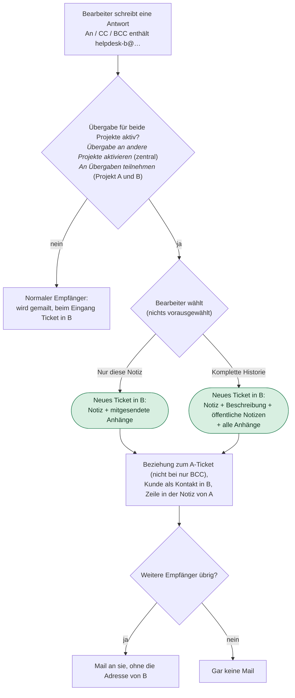

- **Beide Projekte müssen teilnehmen.** Der zentrale Schalter macht die Option in den
  Projekteinstellungen sichtbar; jedes Projekt entscheidet dann selbst, ob es übergibt und
  Übergaben annimmt.
- **Private Notizen bleiben zurück**, auch bei der kompletten Historie: Sie waren für das
  Ausgangsteam geschrieben.
- Autor des Tickets in B ist der Bearbeiter, es erhält die *Standardwerte für neue Tickets* des
  Postfachs und *Neue Tickets zuweisen an* von B (sonst Redmines Projektstandard). Übergabeziele sind nur Projekte,
  die der Bearbeiter sehen darf; die Adresse jedes anderen Projekts wird wie bisher gemailt. Derselbe Kunde wird Kontakt in B, damit B ihm aus seinem Ticket antworten kann.
- **Mehrere Empfänger**: Jedes teilnehmende Projekt aus An, CC oder BCC erhält ein Ticket, auch
  wenn zwei seiner Postfächer genannt sind. Alle anderen werden wie bisher gemailt; standen in An nur
  Übergabe-Adressen, rückt CC nach An. Blieben nur BCC-Empfänger übrig, wird die Antwort abgelehnt,
  bevor etwas übergeben wird. Ein bewusst geleertes An bleibt leer: Steht nur die Adresse von B in
  CC, wird nichts gemailt, auch nicht an den Kunden.
- **Schlägt die Mail an die übrigen Empfänger fehl**, wird das Ticket in B wieder entfernt, ein
  erneutes Senden legt es also nicht doppelt an – es sei denn, in B hat schon jemand daran
  gearbeitet (eine Änderung, eine Notiz, gebuchte Zeit): Dann bleibt es, und die Fehlermeldung nennt
  es, damit der Bearbeiter beim erneuten Senden die Adresse von B weglässt. Ist die Mail einmal raus, bleibt das Ticket, auch
  wenn das Protokollieren der Antwort danach fehlschlägt; der Bearbeiter wird gewarnt, nicht erneut
  zu senden. Die Benachrichtigung von B über das neue Ticket geht erst dann raus, nie für eine
  zurückgenommene Übergabe.
- Bilder des Tickets, die die Notiz zitiert, gehen mit, auch ohne Haken; Bildverweise im kopierten
  Text zeigen auf die Kopien. Ein nur per BCC erreichtes Projekt wird in der Notiz des
  Ausgangstickets nur genannt, wenn die Notiz privat ist, und sein Ticket wird nicht mit dem
  Ausgangsticket verknüpft.
- **Text aus einem KI-Entwurf** (die Antwortnotiz oder Notizen der kompletten Historie) geht als
  eigene, als KI-Entwurf markierte Notiz über, mit einem Platzhalter in der Beschreibung:
  Wissensbasis und Antwortvorschläge des Zielprojekts lassen ihn aus, wie im Ausgangsprojekt.
- Vor dem Abschluss der Übergabe wird nichts über das neue Ticket verkündet: keine
  Benachrichtigung und bei geschlossenem Standardstatus kein Eintrag in der Wissensbasis.

#### In der Initialmail

Die Initialmail – *Neues Helpdesk-Ticket* und *Kontakt zuordnen* an einem Ticket ohne Kunden –
übergibt genauso, nur gibt es nichts zu wählen: Ein neues Ticket hat noch keine Notizen, also
erhält das andere Projekt, was die Mail enthalten hätte.

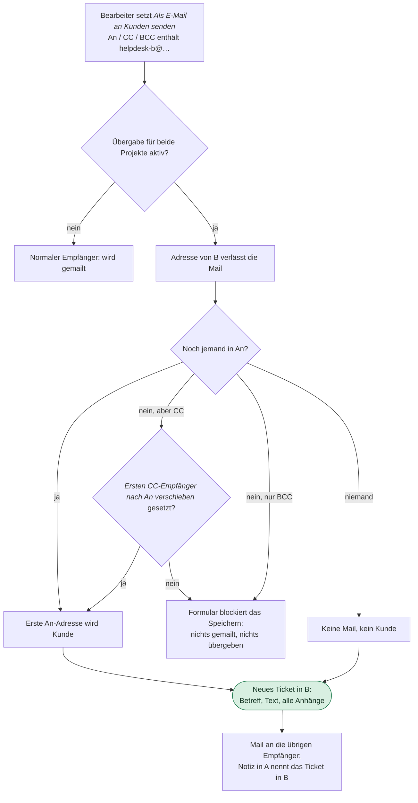

- **Das Formular sagt, was passieren wird**, schon beim Tippen: welche Projekte das Ticket
  erhalten, wer Kunde wird, und eine Warnung, sobald niemand in An übrig ist. Blockiert wird das
  Speichern nur, wenn die Mail nicht wie angezeigt hinausgehen könnte.
- **Schlägt die Mail fehl**, bleibt die Übergabe bestehen – das Ticket existiert ohnehin, und
  niemand wird gebeten, erneut zu senden. Die Ticketseite nennt beides: den Mailfehler und die
  angelegten Tickets.
- Ohne Mail (*Als E-Mail an Kunden senden* nicht gesetzt) wird nichts übergeben; die An-Adresse
  wird wie bisher nur als Kunde verknüpft.

---

## 8. Einstellungsübersicht

**Wo sie zu finden sind**

- **Zentral**: *Administration → Plugins → Redmine expert Helpdesk → Konfigurieren*
- **Projekt**: *Projekt → Einstellungen → Helpdesk*
- **Postfach**: *Projekt → Einstellungen → Helpdesk → Postfächer → (Postfach)*
- **Redmine**: *Administration → Konfiguration*

| Einstellung | Wo | Wirkung | Abschnitt |
| --- | --- | --- | --- |
| Mailabruf pausieren | Zentral | Blockiert jeden Abruf (Wartungsmodus) | [2](#2-abruf) |
| Aktiv | Postfach | Postfach wird überhaupt abgerufen | [2](#2-abruf) |
| Quellordner | Postfach | Ordner, aus dem gelesen wird | [2](#2-abruf) |
| Nur ungelesene Mails abrufen | Postfach (IMAP) | Nur ungelesene statt aller Mails lesen | [2](#2-abruf) |
| Zielordner (verarbeitet / übersprungen / Fehler) | Postfach | Wohin eine Mail danach verschoben wird | [3](#3-filter-wird-die-mail-überhaupt-verarbeitet), [5](#5-was-mit-dem-ticket-passiert) |
| Whitelist / Blacklist | Postfach | Absender, die verarbeitet / übersprungen werden | [3](#3-filter-wird-die-mail-überhaupt-verarbeitet) |
| Automatisierungsregeln, Aktion *Mail ignorieren* | Postfach | Mails nach Betreff oder Absender überspringen | [3](#3-filter-wird-die-mail-überhaupt-verarbeitet) |
| Auto-Reply-Filter aktiv, Absender- / Header-Ausnahmen | Postfach | Abwesenheitsnotizen und Ähnliches überspringen | [3](#3-filter-wird-die-mail-überhaupt-verarbeitet) |
| PhishTank-Integration aktiv | Zentral | Phishing-Feeds werden gespiegelt und geprüft | [3](#3-filter-wird-die-mail-überhaupt-verarbeitet) |
| Phishing-Prüfung für dieses Projekt aktivieren, Aktion bei Phishing-Treffer | Projekt | Links prüfen; *Mail in Quarantäne* überspringt, *Links neutralisieren* ersetzt | [3](#3-filter-wird-die-mail-überhaupt-verarbeitet) |
| Max. Alter (Tage) | Postfach | Antwort auf ein lange geschlossenes Ticket wird ein neues Ticket | [4](#4-antwort-oder-neues-ticket) |
| Unbekannte Absender | Postfach | *Akzeptieren (anonym)*, *Benutzerkonto anlegen* oder *Ignorieren* | [4](#4-antwort-oder-neues-ticket) |
| Standardwerte für neue Tickets (Tracker, Priorität, Status) | Postfach | Attribute eines neuen Tickets | [4](#4-antwort-oder-neues-ticket) |
| Redmine-Benachrichtigungen unterdrücken | Postfach | Keine Redmine-Benachrichtigungen für angelegte Tickets und Notizen | [4](#4-antwort-oder-neues-ticket) |
| Neue Tickets zuweisen an | Projekt | Zuweisung eines neuen Tickets (Benutzer oder Gruppe) | [5](#5-was-mit-dem-ticket-passiert) |
| Automatisierungsregeln (Priorität, Tracker, Kategorie, Zuweisung) | Postfach | Ein neues Ticket nach Betreff oder Absender ändern | [5](#5-was-mit-dem-ticket-passiert) |
| Status (geschlossenes Ticket) / Status (offenes Ticket) | Postfach | Status nach einer Kundenantwort | [5](#5-was-mit-dem-ticket-passiert) |
| Tickets markieren, die auf Bearbeitung warten | Zentral | Tickets mit unbeantworteter Kundenantwort markieren | [5](#5-was-mit-dem-ticket-passiert) |
| Eingebettete Bilder im Ticket anzeigen | Zentral | Eingebettete Bilder erscheinen im Tickettext statt `[cid:…]`-Markierungen | [5](#5-was-mit-dem-ticket-passiert) |
| Gesperrte Anhänge | Projekt, Einträge über die Ticketseite | Bekannte Logos und Tracking-Pixel entfernen | [5](#5-was-mit-dem-ticket-passiert) |
| Autoresponder aktiv, Betreff, Text | Postfach | Bestätigungsmail für ein neues Ticket | [5](#5-was-mit-dem-ticket-passiert), [7](#7-ausgehende-mails) |
| KI-Zusammenfassungen aktivieren, KI-Zusammenfassungen für dieses Projekt erzeugen | Zentral + Projekt | Zusammenfassung als Notiz im Hintergrund | [5](#5-was-mit-dem-ticket-passiert) |
| Vollständigkeitsprüfung aktivieren, Modus | Zentral + Projekt | Rückfrage, wenn der Erstmail Informationen fehlen | [5](#5-was-mit-dem-ticket-passiert), [7](#7-ausgehende-mails) |
| Antworten nur im Projekt des Postfachs zuordnen | Zentral, *Experimentell* | Eine Mail setzt nur Tickets im Projekt des empfangenden Postfachs fort; fremde Marker werden entfernt, die Tickets verknüpft | [4](#4-antwort-oder-neues-ticket), [6](#6-eine-mail-mehrere-projekte) |
| Ticket-Beziehungen zwischen Projekten erlauben | Redmine, *Tickets* | Tickets verschiedener Projekte können verknüpft werden | [6](#6-eine-mail-mehrere-projekte) |
| Versandweg | Postfach | *Backend des Postfachs*, *Microsoft Graph API* oder *SMTP (Redmine-Standard)* | [7](#7-ausgehende-mails) |
| Abweichender Absender (From), Reply-To auf die Postfach-Adresse setzen | Postfach (SMTP-Weg) | Absenderadresse beim Versand über *SMTP (Redmine-Standard)* | [7](#7-ausgehende-mails) |
| Übergabe an andere Projekte aktivieren | Zentral, *Experimentell* | Experimentell: Übergabe statt Mail wird verfügbar | [7](#übergabe-statt-mail-experimentell) |
| An Übergaben teilnehmen | Projekt, *Experimentell* | Dieses Projekt übergibt und nimmt Übergaben an | [7](#übergabe-statt-mail-experimentell) |
| Ordner für gesendete Mails | Postfach (IMAP) | Wo die Kopie einer gesendeten Mail abgelegt wird | [7](#7-ausgehende-mails) |
| Betreff-Vorlage | Projekt | Betreff von Bearbeiterantworten | [7](#7-ausgehende-mails) |
| Kopfzeile, Fußzeile, Fußzeilen-Modus | Postfach (+ zentrale Fußzeile) | Rahmen um den Antworttext | [7](#7-ausgehende-mails) |
| E-Mail-Absender | Redmine, *Mailbenachrichtigung* | Mails von dieser Adresse werden abgelehnt | [4](#4-antwort-oder-neues-ticket) |
| Schneide E-Mails nach einer dieser Zeilen ab, Anhänge nach Namen ausschließen | Redmine, *Eingehende E-Mails* | Wendet der `MailHandler` auf jede Mail an | [4](#4-antwort-oder-neues-ticket) |
