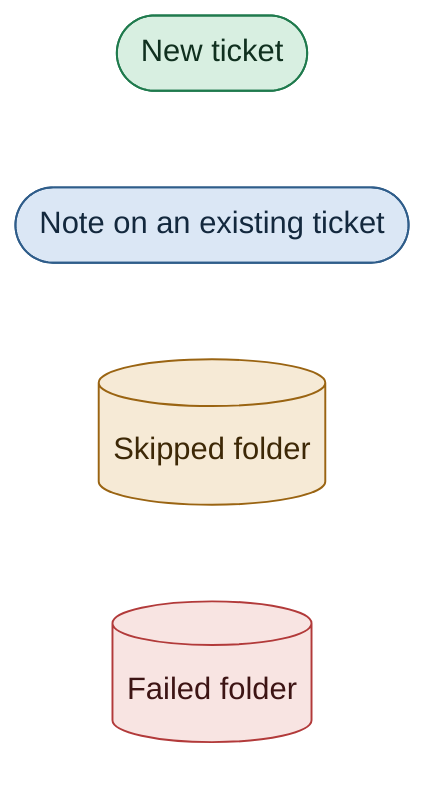
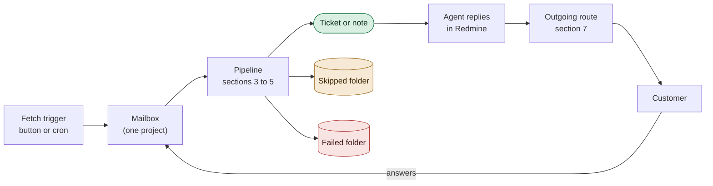
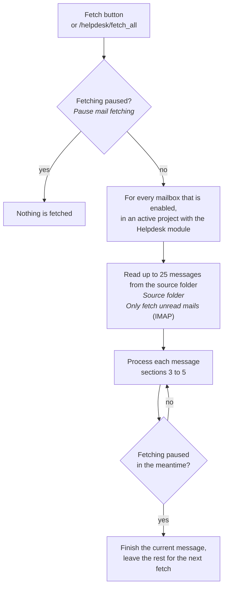
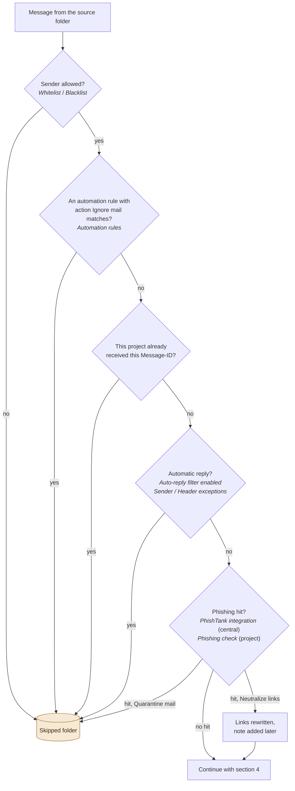
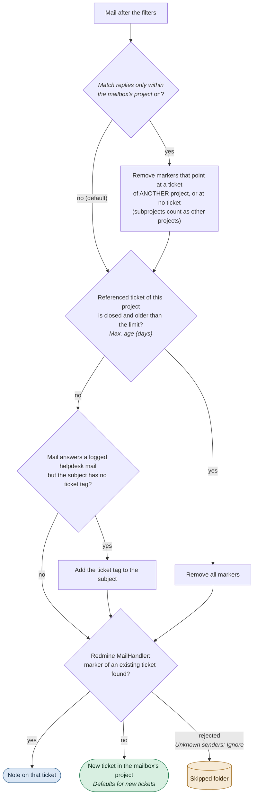
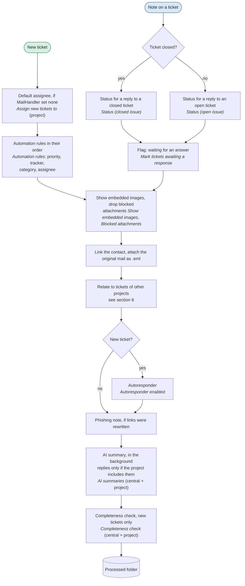
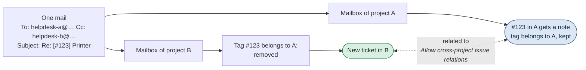
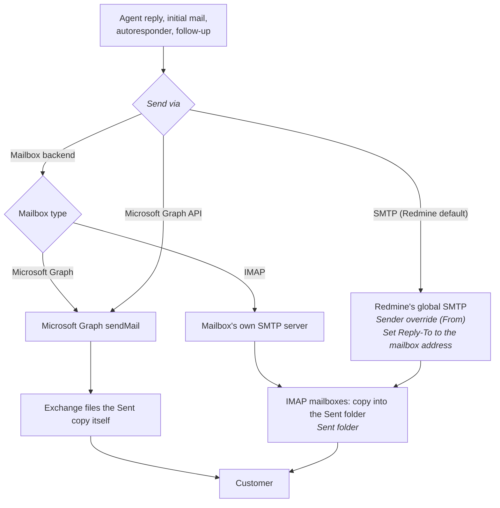
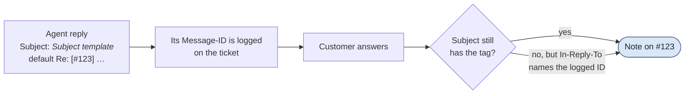

# Email flow – redmine_expert_helpdesk

> 🇬🇧 English version · [Deutsche Version](EMAIL_FLOW.de.md)

How a mail travels through the helpdesk: from the mailbox into a ticket, and from the ticket back
to the customer. Every diagram names the settings that change its path, and the
[settings reference](#8-settings-reference) at the end lists all of them with the place they are
configured.

**How to read the diagrams**: rounded boxes are steps, diamonds are decisions, and the label next
to a step names the setting that controls it (*in italics*). Colours mark where a mail ends up:

## Contents

1. [The big picture](#1-the-big-picture)
2. [Fetching](#2-fetching)
3. [Filters: is the mail processed at all?](#3-filters-is-the-mail-processed-at-all)
4. [Reply or new ticket?](#4-reply-or-new-ticket)
5. [What happens to the ticket](#5-what-happens-to-the-ticket)
6. [One mail, several projects](#6-one-mail-several-projects)
7. [Outgoing mail](#7-outgoing-mail)
8. [Settings reference](#8-settings-reference)

---

## 1. The big picture

A mailbox belongs to exactly one project. Fetching reads its source folder, every message runs
through the same pipeline, and the message is moved to one of three folders afterwards. Replies
written in Redmine leave through the mailbox's outgoing route, and the customer's answer arrives
in the source folder again.

---

## 2. Fetching

There is no scheduler inside the plugin. A fetch starts from the button in the project settings or
from the cron endpoint `GET /helpdesk/fetch_all?key=…`, which also runs the SLA breach check and
the phishing feed sync.

- **IMAP** reads all messages of the source folder, or only unread ones when *Only fetch unread
  mails* is set. Microsoft Graph always reads unread messages only.
- A processed mail is marked as read and moved, so it is never picked up twice.

---

## 3. Filters: is the mail processed at all?

Before a ticket is touched, five checks can send a mail straight to the skipped folder. They run in
this order, cheapest first.

- **Whitelist / Blacklist**: one address or domain per line. A filled whitelist admits *only* its
  senders; the blacklist then removes senders from what is left.
- **Already received**: the same mail reaching two mailboxes of one project (To and Cc) is processed
  once. Another project receiving it is not a duplicate, see [section 6](#6-one-mail-several-projects).
- **Auto-reply filter**: out-of-office and similar mails are recognised by their headers.
  Bounce messages (NDRs) are never filtered, because a failed delivery is something an agent needs
  to see.
- **Skipped folder** falls back to the processed folder when empty. When both are empty the mail
  stays in the source folder and is only marked as read.

---

## 4. Reply or new ticket?

The plugin hands the mail to Redmine's own `MailHandler`, which makes the final decision. Before
that, the plugin adjusts the mail's *thread markers*, the parts of a mail that say which ticket it
belongs to:

| Marker | Where | Example |
| --- | --- | --- |
| Ticket tag | Subject | `Re: [#123] Printer broken`, `[Project - Bug #123]` |
| Redmine notification ID | `In-Reply-To` / `References` | `<redmine.issue-123.20261014…@example.com>` |
| Logged helpdesk Message-ID | `In-Reply-To` / `References` | ID of a customer mail or an agent reply the helpdesk stored |
| Forum reply tag | Subject | `Re: [Board - msg45] …` — always removed, a helpdesk mailbox never posts into a forum |

- **Only the mailbox's own project** (experimental, off by default). Without this step,
  `MailHandler` follows a marker into any project, and anyone who knows a ticket number can write
  into that ticket — that is how it behaves while the switch is off. Markers of the own project are
  kept, so the customer's ordinary reply still finds its ticket. A ticket opened through this
  mailbox and moved to another project since counts as the own project too. A subject naming more
  than 20 ticket numbers, nested more than five levels or longer than 998 characters loses all of
  its tags and brackets, and `In-Reply-To`/`References` with more than 50
  message ids are dropped. The `.eml` attached to
  the ticket keeps the subject and headers exactly as received.
- **Max. age (days)** forces a new ticket for an answer to a ticket that was closed long ago. `0`
  or empty turns the limit off.
- **Unknown senders** decides what `MailHandler` does with an address that has no Redmine account:
  *Accept (anonymous)*, *Create user account*, or *Ignore* (the mail is skipped).
- `MailHandler` also rejects mails from Redmine's own *Emission email address*, and applies Redmine's
  *Incoming emails* settings (*Truncate emails after one of these lines*, *Exclude attachments by
  name*).

---

## 5. What happens to the ticket

After `MailHandler` has created the ticket or the note, the plugin finishes the job. The two
branches differ only at the start.

- **Status on a reply**: either status left empty means the ticket's status stays as it is. A
  closed ticket that ends up in an open status counts as *reopened*.
- **Waiting for an answer** is not set when the mail was written by an agent.
- **AI summary** runs for new tickets, and for replies only when the project's scope includes them.
  The **completeness check** runs for new tickets only. Both run in the background and never stop
  the fetch.
- **Any error** in this pipeline moves the mail to the **failed folder** and the fetch continues
  with the next message. The error is shown on the mailbox (*last error*).

---

## 6. One mail, several projects

Customers often write to several helpdesk addresses at once (To, Cc or Bcc), and colleagues in one
project may not know that another project is involved. With *Match replies only within the
mailbox's project* on, each mailbox handles its copy for its own project only. Everything in this
section applies only then; while it is off, every copy follows its markers into the referenced
ticket, as before.

| Situation | Result |
| --- | --- |
| Customer writes to A and B | One ticket in A, one in B, related to each other |
| Mail to B quoting `[#123]` of project A | New ticket in B, related to #123 |
| Answer to an A conversation, sent to B | New ticket in B, related to the A ticket |
| Agent of A replies with B's address in Cc | New ticket in B; nothing comes back into A |
| Stranger quotes a ticket of a project without Helpdesk | New ticket, no relation |
| Same mail reaches two mailboxes of one project | One ticket; the second copy is skipped |

**How the projects learn about each other**

- **Relation *related to***: added without a history entry or notification. Redmine shows it only to
  users who may see both tickets. A removed ticket tag only leads to a relation when that ticket's
  project has the Helpdesk module, because anyone can type a ticket number into a subject. Needs
  Redmine's *Allow cross-project issue relations*; without it the tickets are created but not
  linked.
- **Sidebar *Also received by***: the other helpdesk addresses from To and Cc. The project name
  appears only for viewers who may see that project. Mailboxes reached by Bcc stay invisible.

---

## 7. Outgoing mail

Four kinds of mail leave the helpdesk, and all of them take the mailbox's outgoing route:

| Mail | Triggered by |
| --- | --- |
| Agent reply | *Reply* on the ticket page |
| Initial mail | Assigning a contact to a ticket, or *New helpdesk ticket* |
| Autoresponder | A new ticket, when *Autoresponder enabled* |
| Completeness follow-up | The completeness check finding the first mail incomplete |

- ***Send via* Microsoft Graph API** is only offered for a Graph mailbox, or an IMAP mailbox on
  Microsoft 365 when the central app registration is configured.
- **SMTP (Redmine default)** embeds inline images as data URIs. The other two routes send them as attachments
  referenced from the HTML.

**How the customer's answer finds its ticket again**

- The **subject template** of the project settings builds the subject; the default carries the
  ticket tag. A template without `{{issue.id}}` still works, because the reply's Message-ID is
  stored and the customer's mail client sends it back in `In-Reply-To`.
- The **autoresponder** refers to the customer's first mail (`In-Reply-To`), so an answer to it lands
  on the ticket as well.
- **Header** and **footer** of the mailbox frame the reply text. *Footer mode* decides between the
  mailbox footer and the central footer.
- Outgoing mails keep their markers even when another project's helpdesk address is a recipient.
  That project's mailbox removes them on arrival ([section 6](#6-one-mail-several-projects)).

---

## 8. Settings reference

**Where to find them**

- **Central**: *Administration → Plugins → Redmine expert Helpdesk → Configure*
- **Project**: *Project → Settings → Helpdesk*
- **Mailbox**: *Project → Settings → Helpdesk → Mailboxes → (mailbox)*
- **Redmine**: *Administration → Settings*

| Setting | Where | Effect | Section |
| --- | --- | --- | --- |
| Pause mail fetching | Central | Blocks every fetch (maintenance mode) | [2](#2-fetching) |
| Enabled | Mailbox | Mailbox is fetched at all | [2](#2-fetching) |
| Source folder | Mailbox | Folder the mails are read from | [2](#2-fetching) |
| Only fetch unread mails | Mailbox (IMAP) | Read unread mails only instead of all | [2](#2-fetching) |
| Processed / Skipped / Failed folder | Mailbox | Where a mail is moved afterwards | [3](#3-filters-is-the-mail-processed-at-all), [5](#5-what-happens-to-the-ticket) |
| Whitelist / Blacklist | Mailbox | Senders that are processed / skipped | [3](#3-filters-is-the-mail-processed-at-all) |
| Automation rules, action *Ignore mail* | Mailbox | Skip mails by subject or sender | [3](#3-filters-is-the-mail-processed-at-all) |
| Auto-reply filter enabled, Sender / Header exceptions | Mailbox | Skip out-of-office and similar mails | [3](#3-filters-is-the-mail-processed-at-all) |
| Enable PhishTank integration | Central | Phishing feeds are mirrored and checked | [3](#3-filters-is-the-mail-processed-at-all) |
| Enable phishing check for this project, Action on phishing hit | Project | Check links; *Quarantine mail* skips, *Neutralize links* rewrites | [3](#3-filters-is-the-mail-processed-at-all) |
| Max. age (days) | Mailbox | Answer to a long-closed ticket becomes a new ticket | [4](#4-reply-or-new-ticket) |
| Unknown senders | Mailbox | *Accept*, *Create user account* or *Ignore* | [4](#4-reply-or-new-ticket) |
| Defaults for new tickets (tracker, priority, status) | Mailbox | Attributes of a new ticket | [4](#4-reply-or-new-ticket) |
| Suppress Redmine notifications | Mailbox | No Redmine notification mails for created tickets and notes | [4](#4-reply-or-new-ticket) |
| Assign new tickets to | Project | Assignee of a new ticket (user or group) | [5](#5-what-happens-to-the-ticket) |
| Automation rules (priority, tracker, category, assignee) | Mailbox | Change a new ticket by subject or sender | [5](#5-what-happens-to-the-ticket) |
| Status (closed issue) / Status (open issue) | Mailbox | Status after a customer reply | [5](#5-what-happens-to-the-ticket) |
| Mark tickets awaiting a response | Central | Flag tickets with an unanswered customer reply | [5](#5-what-happens-to-the-ticket) |
| Show embedded images in the ticket | Central | Embedded images appear in the ticket text instead of `[cid:…]` markers | [5](#5-what-happens-to-the-ticket) |
| Blocked attachments | Project, entries added from the ticket page | Drop known logos and tracking pixels | [5](#5-what-happens-to-the-ticket) |
| Autoresponder enabled, subject, body | Mailbox | Confirmation mail for a new ticket | [5](#5-what-happens-to-the-ticket), [7](#7-outgoing-mail) |
| Enable AI summaries, Generate AI summaries for this project | Central + project | Summary note in the background | [5](#5-what-happens-to-the-ticket) |
| Enable completeness check, Mode | Central + project | Follow-up mail when the first mail lacks information | [5](#5-what-happens-to-the-ticket), [7](#7-outgoing-mail) |
| Match replies only within the mailbox's project | Central, *Experimental* | A mail only continues tickets of the receiving mailbox's project; foreign markers are removed, the tickets related | [4](#4-reply-or-new-ticket), [6](#6-one-mail-several-projects) |
| Allow cross-project issue relations | Redmine, *Issue tracking* | Tickets of different projects can be related | [6](#6-one-mail-several-projects) |
| Send via | Mailbox | Outgoing route: *Mailbox backend*, *Microsoft Graph API* or *SMTP (Redmine default)* | [7](#7-outgoing-mail) |
| Sender override (From), Set Reply-To to the mailbox address | Mailbox (SMTP route) | Sender address when sending via *SMTP (Redmine default)* | [7](#7-outgoing-mail) |
| Sent folder | Mailbox (IMAP) | Where the copy of a sent mail is filed | [7](#7-outgoing-mail) |
| Subject template | Project | Subject of agent replies | [7](#7-outgoing-mail) |
| Header, Footer, Footer mode | Mailbox (+ central footer) | Frame around the reply text | [7](#7-outgoing-mail) |
| Emission email address | Redmine, *Email notifications* | Mails from this address are rejected | [4](#4-reply-or-new-ticket) |
| Truncate emails after one of these lines, Exclude attachments by name | Redmine, *Incoming emails* | Applied by `MailHandler` to every mail | [4](#4-reply-or-new-ticket) |
